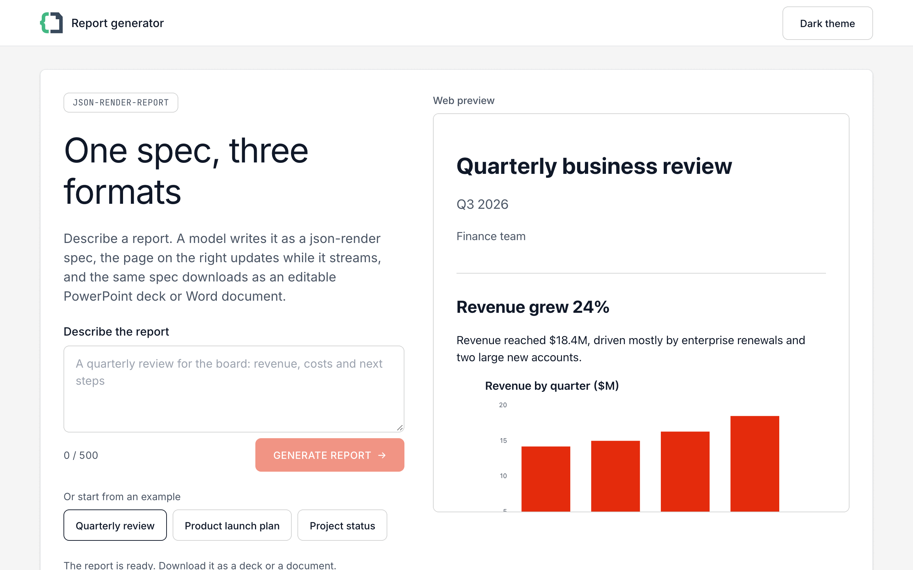
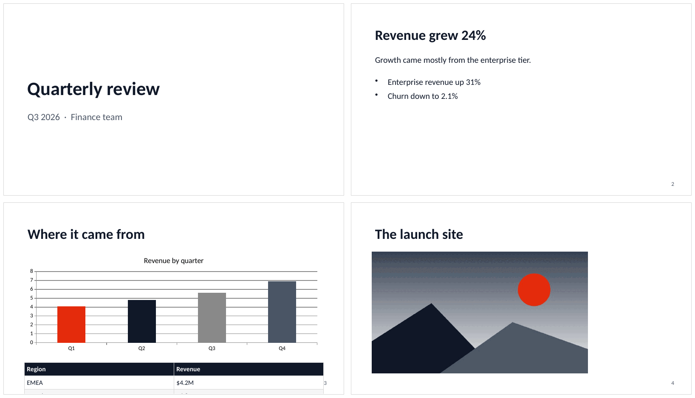
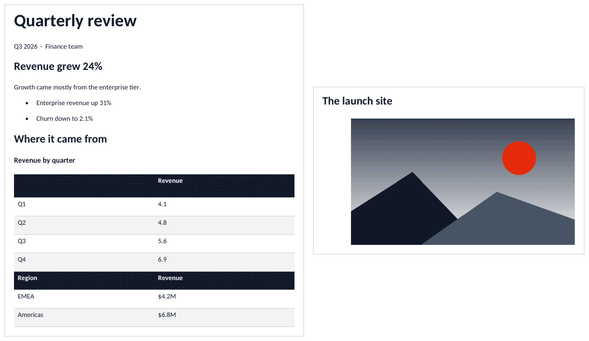

<p align="center">
  
</p>

# json-render-office

Editable PowerPoint and Word files from [json-render](https://github.com/vercel-labs/json-render) specs.

A model writes a JSON spec that follows a catalog. These packages turn that spec into a real `.pptx` or `.docx`: text boxes, tables and native charts you can keep editing in Office. No flattened images, no headless Office at runtime, and it works in Node and in the browser.

> Community project. Not affiliated with or endorsed by Vercel. "json-render" is the name of the Vercel Labs project these packages render for.

[Docs](https://json-render-office-docs.vercel.app) · [Demo](https://json-render-office.vercel.app) · [Changelog](packages/json-render-report/CHANGELOG.md)

<a href="https://json-render-office.vercel.app">
  <picture>
    <source media="(prefers-color-scheme: dark)" srcset=".github/assets/generator-dark.png">
    
  </picture>
</a>

## Packages

| Package                                             | What it does                                                                                              |
| --------------------------------------------------- | --------------------------------------------------------------------------------------------------------- |
| [`json-render-pptx`](packages/json-render-pptx)     | Slide catalog and renderer, built on [vue-pptx-document](https://github.com/jantursky/vue-pptx-document). |
| [`json-render-docx`](packages/json-render-docx)     | Word catalog and renderer, built on [vue-docx-document](https://github.com/jantursky/vue-docx-document).  |
| [`json-render-report`](packages/json-render-report) | One report catalog rendered to a web page, a deck and a document.                                         |
| [`json-render-office`](packages/json-render-office) | Shared pieces: spec walker, image loading, theme, schema helper.                                          |

## Install

```bash
npm install json-render-pptx @json-render/core zod vue
```

`@json-render/core`, `zod` (v4) and `vue` are peer dependencies.

## Example

```ts
import { defineCatalog } from '@json-render/core'
import { schema, standardComponentDefinitions, renderToBuffer } from 'json-render-pptx'

const catalog = defineCatalog(schema, { components: standardComponentDefinitions })

// catalog.prompt() is the system prompt that teaches the model the components.
const spec = await generateSpec(catalog.prompt(), 'A 5 slide deck on Q3 results')

const bytes = await renderToBuffer(spec) // Uint8Array
```

One spec for a web preview, a deck and a document:

```ts
import { renderToDocx, renderToPptx } from 'json-render-report'

const pptx = await renderToPptx(reportSpec)
const docx = await renderToDocx(reportSpec)
```

## How it works

1. `schema` and `standardComponentDefinitions` (`packages/*/src/schema.ts`, `catalog.ts`) describe the components with Zod. `defineCatalog` turns them into the prompt the model sees. They are also exported from a server-safe `/server` entry that pulls in neither Vue nor a writer.
2. The model streams a flat spec: `root` plus `elements`, each with `type`, `props` and `children` keys.
3. `walkSpec` (`packages/json-render-office/src/walk.ts`) resolves `visible`, `repeat` and prop expressions with `@json-render/core`, then looks each type up in a registry of Vue components. Missing roots, missing children and unknown types are skipped and reported through `onWarn`, so a half-streamed spec renders.
4. Images are loaded first (`images.ts`). Only `https:` URLs and `data:` images are read, with a timeout, a type check and a size cap.
5. The standard components are thin wrappers over [vue-pptx-document](https://github.com/jantursky/vue-pptx-document) and [vue-docx-document](https://github.com/jantursky/vue-docx-document). Those libraries run a custom Vue renderer and write the file with PptxGenJS and `docx`.
6. Slides never take coordinates. A slide layout and flexbox place the content, so the model does not have to guess positions. Long text can still overflow its box: the catalog limits (bullets per list, characters per title) are there to keep it in.

## What comes out

The same report spec as a deck and as a document, opened in LibreOffice:

<p>
  
  
</p>

## Compatibility

"Checked" means I opened the generated file and looked at it. Everything else is unverified.

| Feature                                                  | LibreOffice 26.8.3.1 | PowerPoint | Word       | Keynote    | Pages      | Google Slides/Docs |
| -------------------------------------------------------- | -------------------- | ---------- | ---------- | ---------- | ---------- | ------------------ |
| PPTX: cover, title, bullets, numbered list, slide number | Checked 2026-11-17   | Unverified |            | Unverified |            | Unverified         |
| PPTX: two columns, table, bar chart                      | Checked 2026-11-17   | Unverified |            | Unverified |            | Unverified         |
| PPTX: other chart types, images, speaker notes           | Opens, not looked at | Unverified |            | Unverified |            | Unverified         |
| DOCX: title, headings, list, table, image, page break    | Checked 2026-11-17   |            | Unverified |            | Unverified | Unverified         |
| DOCX: header, footer, page numbers, table of contents    | Checked 2026-11-17   |            | Unverified |            | Unverified | Unverified         |
| DOCX: landscape, other page sizes, margins               | Unverified           |            | Unverified |            | Unverified | Unverified         |

CI also opens the generated files in LibreOffice as a test oracle (never at runtime) and runs them through the Open XML SDK validator.

## Prior art

These projects solve parts of the same problem. I read their repositories before writing this.

- [json-to-office](https://github.com/Wiseair-srl/json-to-office) (MIT) renders a JSON tree to `.docx` and `.pptx` with native charts, a validate-and-repair loop and an MCP server. It is the closest project. It has its own component format, with no json-render catalog or spec streaming that I found.
- [pptxgenjs-jsx](https://github.com/artifact-kit/pptxgenjs-jsx) (MIT) is a typed JSX layer over PptxGenJS for model-written decks. PPTX only, and its input is JSX, not a JSON spec.
- [json-to-ppt](https://github.com/jsonforge/json-to-ppt) (MIT) is a Python generator driven by a JSON Schema with absolute positions. PPTX only.
- The [PPTX and DOCX skills](https://github.com/anthropics/skills) have the model write PptxGenJS or docx-js code. They are instructions, not a library.

What json-render-office adds is the json-render side: one catalog that the web, a deck and a document all read, json-render's spec streaming and validation, and Vue-based registries you can extend with your own components.

## Not covered yet

- PDF output. The report spec could be mapped to `@json-render/react-pdf`; this repo does not ship that.
- Charts in Word documents. The report catalog writes a table of the numbers instead.
- XLSX, slide transitions and animations, tracked changes, comments, SmartArt, embedded fonts.
- Custom slide masters and templates.
- Shapes as a catalog component.

## Development

```bash
bun install
bun run build
bun run check
```

`bun run --filter json-render-report test:oracle` opens the generated files in LibreOffice. It needs `soffice` and `pdfinfo` on the path.

<!-- PROJECTS:START -->

## Other Projects & Products

<table align="center">
  <tr>
    <td align="center" valign="top" width="33%">
      <a href="https://github.com/jantursky/" target="_blank" rel="noopener noreferrer">
        <picture>
          <source media="(prefers-color-scheme: dark)" srcset="https://apptiary.com/projects/icons/github-dark.svg">
          
        </picture>
        <br><b>GitHub Profile</b>
      </a>
      <br><sub>Open-source repositories &amp; code</sub>
    </td>
    <td align="center" valign="top" width="33%">
      <a href="https://podcasttotranscript.com/?utm_source=json-render-office&amp;utm_medium=readme&amp;utm_campaign=other-projects&amp;utm_content=podcast-to-transcript" target="_blank" rel="noopener noreferrer">
        <picture>
          <source media="(prefers-color-scheme: dark)" srcset="https://apptiary.com/projects/icons/podcasttotranscript-dark.svg">
          
        </picture>
        <br><b>Podcast To Transcript</b>
      </a>
      <br><sub>Podcast transcripts, summaries &amp; chapters</sub>
    </td>
    <td align="center" valign="top" width="33%">
      <a href="https://loupekit.com/?utm_source=json-render-office&amp;utm_medium=readme&amp;utm_campaign=other-projects&amp;utm_content=loupekit" target="_blank" rel="noopener noreferrer">
        <picture>
          <source media="(prefers-color-scheme: dark)" srcset="https://apptiary.com/projects/icons/loupekit-light.svg">
          
        </picture>
        <br><b>LoupeKit</b>
      </a>
      <br><sub>Tech stack, design tokens, AI code checker</sub>
    </td>
  </tr>
  <tr>
    <td align="center" valign="top" width="33%">
      <a href="https://textarray.com/?utm_source=json-render-office&amp;utm_medium=readme&amp;utm_campaign=other-projects&amp;utm_content=textarray" target="_blank" rel="noopener noreferrer">
        <picture>
          <source media="(prefers-color-scheme: dark)" srcset="https://apptiary.com/projects/icons/textarray-light.svg">
          
        </picture>
        <br><b>TextArray</b>
      </a>
      <br><sub>Online text transformation tool</sub>
    </td>
    <td align="center" valign="top" width="33%">
      <a href="https://addonhive.com/?utm_source=json-render-office&amp;utm_medium=readme&amp;utm_campaign=other-projects&amp;utm_content=addonhive" target="_blank" rel="noopener noreferrer">
        <picture>
          <source media="(prefers-color-scheme: dark)" srcset="https://apptiary.com/projects/icons/addonhive-dark-v3.svg">
          
        </picture>
        <br><b>AddonHive</b>
      </a>
      <br><sub>Addons &amp; integrations hub</sub>
    </td>
    <td align="center" valign="top" width="33%">
      <a href="https://apptiary.com/mobile/games/?utm_source=json-render-office&amp;utm_medium=readme&amp;utm_campaign=other-projects&amp;utm_content=mobile-games-and-apps" target="_blank" rel="noopener noreferrer">
        <picture>
          <source media="(prefers-color-scheme: dark)" srcset="https://apptiary.com/projects/icons/stores-dark-v2.svg">
          
        </picture>
        <br><b>Mobile Games &amp; Apps</b>
      </a>
      <br><sub>Android &amp; iOS Applications</sub>
    </td>
  </tr>
  <tr>
    <td align="center" valign="top" width="33%">
      <a href="https://jantursky.com/?utm_source=json-render-office&amp;utm_medium=readme&amp;utm_campaign=other-projects&amp;utm_content=and-more" target="_blank" rel="noopener noreferrer">
        <picture>
          <source media="(prefers-color-scheme: dark)" srcset="https://apptiary.com/projects/icons/more-dark.svg">
          
        </picture>
        <br><b>And more</b>
      </a>
      <br><sub>More projects, writing &amp; contact</sub>
    </td>
  </tr>
</table>
<!-- PROJECTS:END -->

## License

MIT
